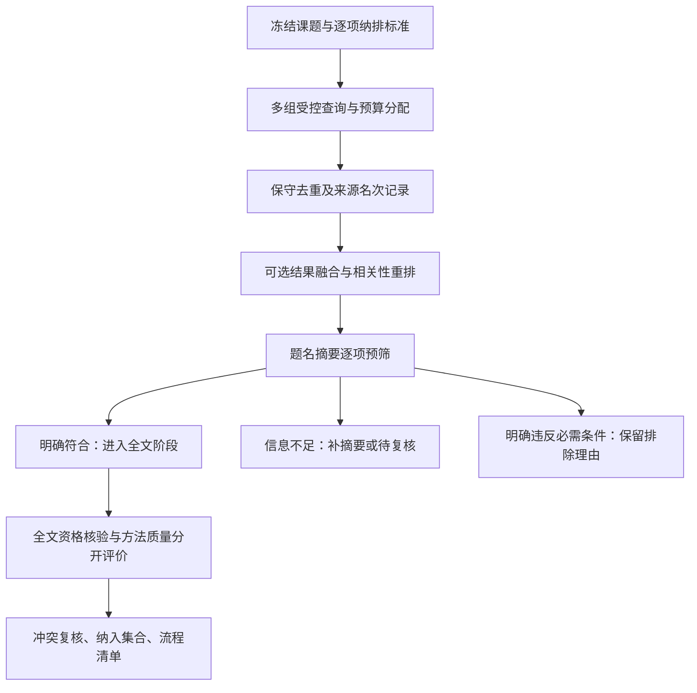

# 文献检索与筛选融合调研

调研日期：2026-10-20（Asia/Shanghai）。状态：方案调研，尚未实现或验证新增筛选能力。

本次检查了项目源码、上游仓库、官方文档和原始论文。GitHub API 返回匿名限流，星数采用本次仓库网页显示的快照与约数，不能视为长期不变的数据。没有安装第三方依赖、下载模型、提交知网检索或更改运行配置。

## 结论与范围

可以融合。优先补齐逐项纳排标准、题名摘要与全文分阶段判断、证据定位、可恢复决定和独立评测，再考虑语义重排与主动学习。当前默认候选上限为 100，直接引入完整主动学习平台或第二套 Agent 调度，工程成本与收益尚不匹配。

需要分别保存三种结果：

- 相关性：研究对象、问题、方法或情境是否符合课题；可以由证据支持的结构化标准判断。
- 阅读优先级：先看哪篇；检索融合、重排和主动学习输出用于排序。
- 方法质量：研究设计和论证有什么支持、缺陷与未知；沿用学科评价，但不能用相关性分数代替。

以下接口、状态、公式应用和开发顺序是本项目的设计建议，不是已实现功能，也不意味着上游项目提供相同契约。

## 上游项目与可借鉴点

| 来源 | 本次网页星数 | 已核实的能力 | 建议用途 |
| --- | --- | --- | --- |
| [ASReview](https://github.com/asreview/asreview) | 约 1.0k | 根据标注持续调整待筛记录顺序，支持模拟评测 | 大候选集合的优先筛选；首先保留导入导出适配路径 |
| [PaperQA](https://github.com/Future-House/paper-qa) | 约 9.4k | 候选检索、片段检索、按问题生成带评分的证据摘要、再组织回答 | 借鉴证据准备过程；不将问答分数当作论文纳入结论 |
| [FlagEmbedding](https://github.com/FlagOpen/FlagEmbedding) | 约 12.3k | 多语言嵌入与重排；包括支持中文使用的 bge-reranker-v2-m3 | 在已取得的题名摘要和正文片段中实验相关性重排 |
| [CoLRev](https://github.com/CoLRev-Environment/colrev) | 47 | 检索、去重、摘要预筛、PDF 全文筛选及过程追踪 | 借鉴筛选阶段、逐项标准和历史记录；它不是高星项目 |
| [GPT Researcher](https://github.com/assafelovic/gpt-researcher) | 约 30.2k | 通用研究 Agent 与报告工作流 | 作为对照；不优先作为本项目的学术筛选内核 |

上述可借鉴机制已于 2026-10-20 补入主[项目实施规格](学术文献MCP项目实施规格.md)第 20 节。主规格规定交付边界与验收，本文件保留调研依据、接入细节和上游机制说明。

补充来源：

- [CoLRev search-query](https://github.com/CoLRev-Environment/search-query)：6 星，支持学术检索式检查、翻译等。可借鉴查询结构，但尚未证实其语法可直接用于当前知网页面适配器。
- [PRISMA 流程图](https://www.prisma-statement.org/prisma-2020-flow-diagram)：记录识别、筛选、排除、纳入及原因，是报告方法，不是论文质量评分器。
- [RRF 原始论文](https://cormack.uwaterloo.ca/cormacksigir09-rrf.pdf)：提供基于名次的结果融合方法；不能把其通用检索实验结论直接推广为中文学术筛选效果。

ASReview 与 PaperQA 仓库标示 Apache-2.0，FlagEmbedding 和 CoLRev 代码仓库标示 MIT；[bge-reranker-v2-m3 模型卡](https://huggingface.co/BAAI/bge-reranker-v2-m3)标示 Apache-2.0。代码、文档、模型权重分别登记来源和适用许可；本次仅撰写原创设计建议，没有复制上游实现。

## 当前项目的接入基础与缺口

| 当前位置 | 已有基础 | 缺口或接入方式 |
| --- | --- | --- |
| `models.py / ScreeningRules` | 不可变规则、年份、类型、来源和引用约束 | 新增版本化的课题纳排标准，不把自然语言标准直接转换为无依据的分数 |
| `app.py / search_papers` | 字段和排序核验、游标、预算、查询历史 | 多轮查询的分配与合并；保留每个来源名次和截断范围 |
| `screening.py / Screening.run` | 题录规则、学科评分、未知项、四种结果 | 明确分开课题纳入判断、优先级和方法质量；增加题名摘要阶段 |
| `review_models.py / ReviewPlanInput` | 自由文本纳排标准、同义词、计划与已执行查询 | 自由文本还不能执行；新增稳定 criterion_id、版本和证据要求 |
| `review_workspace.py / references` | 快照、原文片段、摘要观测和引语子串校验 | 复用定位与许可检查，增加结构化筛选决定；不能将筛选强制绑定到可选综述开关 |
| `review_evidence.py / search` | 字面词、中文双字、同义词、原始证据身份 | 保留当前方法作为基线，增加可选重排后端 |
| `app.py / export_project` | 查询、筛选及覆盖历史导出 | 新增按唯一版本与阶段统计的流程清单；不能简单把多次决定数当论文数 |

流程报告可借鉴 PRISMA，但仅生成计数清单不等于完整符合 PRISMA。需区分检索记录、论文报告与实际研究；同一研究的多篇报告不能自动计为独立研究，没有确认的对应关系保留未知。

现有列表解析并没有采集引用次数和撤稿核验信息。不得把相关字段为空解释为零引用或确定未撤稿。当前规则输出还将相关性标为 `not_assessed`。

严格全文筛选在没有缺失项时才检查覆盖率，因而默认 80% 门槛目前实际上被所有适用项完成这一条件覆盖。新增方案应显式区分核心维度与补充维度，或明确要求全部完成；不能声称当前实现已经能在允许部分未知时执行 80% 门槛。

## 建议流程



### 1. 查询计划与结果融合

将问题拆为概念组，登记同义词、字段、查询目标和每组预算。概念组的组合属于计划表达；当前 provider 没有验证复杂布尔 DSL，执行时必须编译为现有受控查询，不能直接把 AND/OR 文本当作已支持的来源逻辑。

同一总预算内预留多组查询额度，避免第一组耗尽全部候选额度。在线请求仍遵守串行会话、既有间隔和许可。保留 query_id、source_id、结果位置、排序、来源页、采集时间、截断状态；重复命中保留关联，不重复计为不同论文。

可试验 RRF：`score(d) = Σ 1 / (k + rank_i(d))`，只对文献实际出现的列表求和。每个列表内先去重，完全相同的重复查询不能重复投票。原论文使用 k=60，可作为实验起点而非已校准的中文最优参数。RRF 只决定阅读顺序，不作为排除阈值。多个相似查询会放大相同表述的权重，需对查询组去重并开展消融比较。

### 2. 逐项纳排标准：优先实施

建议每条标准保存：`criterion_id / revision_id / description / required / stage / evidence_requirement / examples`。不要把所有课题统一套入医学研究框架；按计算机、经管、理论等研究类型配置对象、问题、设计和情境。

每篇论文、每条标准分别保存：

```text
criterion_id
judgment = meets | violates | unknown | not_applicable
reason
reading_level = metadata_only | abstract_only | fulltext
observation_id 或 evidence_ids
quotation
evaluator_kind = agent | user
model_and_prompt_version（如调用方能够真实提供）
```

`not_applicable` 需要解释与依据。不得通过把必需标准改为不适用来绕过范围限制。字段、版本、快照、引语和项目归属均由服务检查；Agent 提供的身份角色不是认证。

题名摘要阶段的原则：明确违反当前阶段可判定的必需标准才排除；信息不足继续补材料或待复核；满足当前阶段标准仅表示进入下一阶段。摘要没有提到研究设计或对照组，不等于全文没有。摘要截断状态沿用 `partial`，不能把片段缺失解释为明确不符合。

全文阶段重新核验剩余纳入条件。课题资格与方法质量分别记录；背景材料和反证可以保留不同用途，不能因为没有达到核心论据条件就从整个本地库删除。

一个计算机类示例：对象是否为大学生、是否涉及生成式 AI、是否研究学习过程或结果。通过其中两项、另一项未知，应返回待确认，不能平均成 66.7% 然后称为相关性概率。

### 3. 可选中文重排

输入研究问题与已取得的题名摘要，输出排序、模型版本、文本截断范围和输入快照摘要。先完整保留候选集合，仅改变顺序；无摘要者进入补材料队列，不因文本短而被自动排除。

模型卡展示 bge-reranker-v2-m3 直接计算查询与片段的相关分数，并可经 sigmoid 映射至 0—1。由此不能推导出分数已针对本课题校准，更不能解释为论文真实可靠的概率。应与现有字面检索比较，再决定是否启用和是否有必要设阈值。

该后端新增模型权重和推理依赖，需在本机验证运行成本；本次没有实测速度、显存或效果。建议独立可选依赖或本地进程，缺失时明确回退并报告方法。外部后端复用现有内容处理许可，记录新增提供方，不能自动扩大授权范围。

### 4. 证据准备与质量评价

借鉴 PaperQA 的候选、证据、综合分离过程：先定位支持或反驳某条标准的段落，再由当前 Codex 判断，最后交给服务保存。复用现有 evidence_id、observation_id、解析快照和出站检查，不直接引入第二套模型调度和隐藏 API 调用。

现有 0—2 分可以保留，但逐项写明观察点、正反例和未知条件，并保存 rubric_version。完整材料中的明确方法缺陷与尚未检索到证据必须区分。是否将某项设为核心、采用零分否决或允许补充项未知，应在研究方案中明确，不跨学科一刀切。

### 5. 主动学习与停止判断：后续可选

借鉴 ASReview 的“标注—更新顺序—继续标注”，适合候选数明显扩大后的场景。当前 100 篇上限下先评估直接逐项筛选的成本，不能宣称引入主动学习必然节省时间。

优先支持合法题录与人工标签的导出、结果映射及回导验证，不立即嵌入整个 ASReview 服务。只有真实人工核验标签才作为人工标签；Agent 标签单独登记，不冒充专家金标准。同一 Agent 两次检查也不等于两位独立评审者。

[ASReview 停止说明](https://asreview.readthedocs.io/en/stable/lab/progress.html)提供可配置的连续不相关记录阈值，同时指出理想阈值仍在研究。停止建议只作为提示，不能将连续若干篇不相关当作召回率保证。保留未筛集合、抽查策略和停止原因；切换模型检查与抽查也不能证明全库穷尽。

## 最小接口草案

建议独立于增强综述开关新增或扩展以下能力；名称为草案：

1. `save_selection_protocol`：版本化标准、适用阶段、课题范围和查询计划。
2. `save_selection_assessment`：按论文、阶段、标准提交有材料依据的判断，服务生成汇总决定。
3. `get_screening_queue`：返回未处理、缺材料、冲突和待复核项，可选优先级排序。
4. `export_selection_flow`：导出各阶段数量、原因、未决集合、自动与人工判断来源及历史。

现有 `search_papers` 保持单查询兼容。第一版可由 Codex 编排多次查询，无须立刻增加会触发批量网络请求的工具。旧 policy、decision、override 不覆盖，协议变更产生新版本并标记旧决定需复核。新实体的项目隔离、索引、备份迁移与历史导出需随实现确定，不假设仅增加 JSON 字段即可解决。

## 验证与实施顺序

### 第一批：不新增模型依赖

- 逐项标准和题名摘要/全文阶段契约。
- 材料归属、引语定位、部分摘要、未知和不适用校验。
- 决定汇总、冲突复核、规则版本和覆盖历史。
- 查询计划与来源位置记录、按唯一版本与阶段汇总的流程清单。
- 修正或明确严格模式覆盖率与核心项关系。

### 第二批：验证排序增益

- 同一采集预算内比较单查询、查询并集、RRF。
- 保留现有字面检索基线，增加可选中文重排。
- 以同一冻结候选集比较排序；另行评价候选获取效果，不能混淆二者。

### 第三批：扩大规模后验证主动学习

- 与 ASReview 通过题录/标签交换建立可逆映射。
- 在独立全标注集合中模拟不同种子和筛选顺序。
- 检查停止条件、剩余漏检和工作量，后续再考虑深度集成。

评测沿用项目规格：开发样本与独立验收样本分离，建议按既有规格使用约 100 篇开发样本及至少 50 篇独立验收样本，并保证学科和正例分层。相同研究、不同版本、近重复内容必须按组划分，避免评测泄漏。

至少报告：前 K 条相关比例、候选集内 Recall@K、最终纳入精确率与召回率、待复核比例、错误排除数、逐项人工分歧、耗时和判断来源。待复核不能默认计为正确纳入；提供保留集合与未决集合分别计算的统计。Recall@K 的分母必须是明确标注的参考集合，不能声称测得全部知网文献的召回率。

[ASReview 模拟文档](https://asreview.readthedocs.io/en/stable/lab/simulation_overview.html)要求全标注数据，可借鉴其模拟与工作量评测思路；统计表现不能以 Agent 自评分代替。

项目现有 95% 召回率是验收目标，尚未完成独立筛选质量验证。本方案也没有产生新的效果测量。验收后再决定保留哪些排序后端和阈值。

## GPT Researcher：通用研究与报告的生成机制

本节基于本次检查的官方文档和 `main` 分支源码；历史架构文章仅作背景，不能覆盖当前实现。基础研究、递归 Deep Research 和多角色报告工作流是不同路径，并非每次调用默认全部执行。

### 基础路径：规划、收集上下文、写报告

1. 输入研究问题及报告类型、语言、来源范围等配置。来源可为网页、本地文档或混合材料。
2. 先作初始搜索，再将结果与原问题传给规划过程，产生更具体的子查询。
3. 按子查询调用检索器，收集候选网址、抓取正文、排除已访问的重复 URL，并保留来源信息。网页子查询可以并发执行；这不适用于本项目需要串行锁和访问间隔的知网会话。
4. 为每个子问题选择相关段落，合并为研究上下文，再交给写作阶段。
5. 根据报告类型、上下文和配置生成提示，调用写作模型输出报告。主流程明确区分 `conduct_research()` 和 `write_report()`；研究完成与报告生成是两个阶段。

依据：[研究编排源码](https://github.com/assafelovic/gpt-researcher/blob/main/gpt_researcher/skills/researcher.py)、[Python 接口](https://docs.gptr.dev/docs/gpt-researcher/gptr/pip-package)、[检索器文档](https://docs.gptr.dev/docs/gpt-researcher/search-engines)。

### 上下文筛选：判断片段能否帮助回答子问题

当前官方文档区分 `auto / jev / keyword / embeddings / none`。默认 auto 在具备 TypeSafe 凭据时选择 Jev，否则使用本地 BM25；部分后端失败也会回退到关键词方法。该回退仅指上下文筛选，不意味着整套研究和报告不需要模型服务。

Jev 使用四级有用性判断：无关、同主题但不能帮助作答、部分回答或提供支持事实、直接以具体事实回答。等级与门槛用于片段选择，不能据此认证来源可信或论文方法质量。BM25 路径按查询与片段的词项匹配排序；现有字词切分不能直接当作中文学术检索已经通过验证。

依据：[上下文筛选官方说明](https://docs.gptr.dev/docs/gpt-researcher/gptr/context-filter)、[模式选择源码](https://github.com/assafelovic/gpt-researcher/blob/main/gpt_researcher/context/select.py)、[关键词实现](https://github.com/assafelovic/gpt-researcher/blob/main/gpt_researcher/context/lexical.py)。

### 写作、引用与报告导出

写作模块读取已收集的上下文、角色与报告参数，再请求模型生成正文。当前 writer 对完全空白的研究上下文返回无法取得来源材料的说明，避免直接生成看似有依据的报告。子主题报告还接收已有标题和相关已写内容，用于组织章节。

写作提示要求实质性主张、数字和引语附来源链接，只引用已提供材料，并按所选语言、格式和长度组织正文。这是生成约束；没有证据证明每条引用都已由程序独立完成语义核查。输出文件转换也是独立步骤，不能把 PDF 或 Word 格式视作质量保证。

依据：[writer 源码](https://github.com/assafelovic/gpt-researcher/blob/main/gpt_researcher/skills/writer.py)、[报告生成源码](https://github.com/assafelovic/gpt-researcher/blob/main/gpt_researcher/actions/report_generation.py)、[提示实现](https://github.com/assafelovic/gpt-researcher/blob/main/gpt_researcher/prompts.py)。

### 可选路径：递归研究与多角色修订

[Deep Research](https://docs.gptr.dev/docs/gpt-researcher/gptr/deep_research)以宽度控制不同探索方向、深度控制继续追问的层数，并限制并发数量；分支研究结果汇总后再生成报告。更深更广表示更多探索与调用，不自动等于更高准确率。

[LangGraph 多角色工作流](https://docs.gptr.dev/docs/gpt-researcher/multi_agents/langgraph)提供初步研究、编辑规划提纲、各章节研究与草稿、审阅反馈、修订、总稿编写和导出的组织方式，也可引入用户反馈。这些角色主要体现职责、提示和状态流转；多次模型审阅不能当作独立专家验证。

### 在本项目中的具体取舍

建议把“研究子问题—检索计划—材料包—章节—核查反馈”串联起来。每个子问题保存未决项、对应查询及原文依据，每节写作只使用选定快照材料；发现缺口时形成新的受控查询建议，修改后标记受影响章节与核查状态。

上下文筛选增加“直接回答 / 部分支持 / 仅同主题 / 无关或未知”的可复核说明，保留相反证据和原文入口。该说明用于材料准备，不替代纳排协议，也不直接触发低分排除。BM25 与有用性判断可作为后续对照后端，新增外部提供方时另行核验处理许可。

优先复用现有 Codex、MCP、文献卡、综合和逐句核查机制。GPT Researcher 自身可配置 MCP 检索器，但直接连接本服务仍需验证工具参数、串行会话、预算、权限和来源映射，不因都支持 MCP 就声称已经兼容。

通用报告可以混用网页、机构资料和文档形成主题性回答；学术综述还需逐篇资格筛选、发表版本和研究关系、全文方法评价及可定位证据。采用其研究编排不取消这些学术要求。
