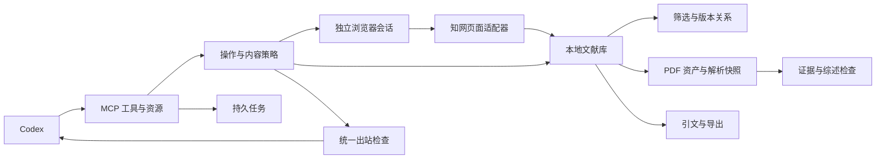

# 架构与工具契约

本地单用户 stdio 服务，无独立 Agent 调度或模型调用。官方 Python MCP SDK 的 1.x 维护分支固定在锁文件，使用 FastMCP 参数校验及结构化返回。Python 3.12 为主验证环境；Node.js 仅运行本地 citeproc-js 引文渲染子进程，不联网。

## 文件分工

| 文件 | 责任 |
| --- | --- |
| `server.py` / `__main__.py` | 工具注册、资源、工作流提示、stdio 生命周期与配置校验 |
| `app.py` | 应用用例、统一响应、项目预算、游标和输出边界 |
| `config.py` / `policy.py` | 严格学校及客户端配置、三态操作许可、来源内容输出 |
| `access.py` / `providers.py` | 临时独立上下文、精确主机检查、机构识别、受控页面操作 |
| `core.py` / `library.py` | SQLite、项目文献关系、不可变观测、作品版本、候选关系及合并回滚 |
| `screening.py` | 元数据规则与五学科模板；评分需实际证据，未知不当作零 |
| `parsing.py` / `pdf_worker.py` | 文件签名、PDF 结构、哈希、可杀死子进程解析、证据定位 |
| `reviews.py` | 基础矩阵、阅读层级、草稿与引用身份/引语检查 |
| `review_models.py` / `review_workspace.py` | 增强输入契约、开关、计划、快照、卡片及不可变修订 |
| `review_evidence.py` / `review_preparation.py` | 问题检索、上下文、返回进度和材料作业检查点 |
| `review_writing.py` / `writing.py` | 多来源论断、章节、逐句核查与版本化写作提示 |
| `review_revisions.py` / `review_export.py` | 反向依赖、差异和统一引文的双格式导出 |
| `citations.py` / `js/` | 元数据格式交换、citeproc-js 本地 CSL 渲染 |
| `jobs.py` | 持久幂等键、状态、取消与显式恢复 |

SQLite `records` 存储带稳定标识的类型化实体，JSON 负载保留来源快照；`project_papers` 以外键保存项目与发表版本关系；`audit` 记录请求标识、方法、结果、错误码、耗时、阶段、任务标识和固定来源类别，不保存请求参数或正文。长任务结束、取消和中断另记 `stage=job`，与受理请求分开。数据目录采用操作系统文件锁，单目录只允许一个服务实例，避免另一进程把仍在运行的会话和任务误标为中断。退出或崩溃后操作系统释放锁；多实例需明确选择不同数据目录。

当前 0.2.1 的 schema 为 `user_version=4`。首次创建依次执行版本 1～4；旧库在升级前使用 SQLite backup API 生成包含已提交 WAL 页的一致数据库快照，并写出 SHA-256、版本及不可变资产保留说明的 JSON 清单，存于数据根目录的 `backups/`。升级语句和版本号在同一事务内提交；失败则回滚并释放目录锁，原始资产和解析文件保持原位。普通重启不重复备份，拒绝较新 schema 时不修改数据库。旧审计行没有耗时或诊断类别时保持 NULL，不伪造历史测量。schema 4 增加按版本、解析产物、资产及幂等键查找的表达式索引和 `audit.diagnostic_code`。

如需恢复，先停止所有使用该数据目录的服务，保留故障目录；核对备份清单中的哈希，在另一个数据目录验证数据库快照及原有 `assets/`、`parses/`。确认题录、关联和证据可读后再切换本地配置。服务不会自动用旧备份覆盖当前库，且备份不包含浏览器身份材料。

资产以 SHA-256 命名。发表版本、资产、解析产物和证据使用不同标识。相同文件跨版本复用物理存储，但授权和关联分开记录。首次读取默认选定解析快照，后续新文件不自动改变旧证据；历史重放应显式传入 `asset_id` 与 `parse_artifact_id`。

## 工具

| 分组 | 工具 |
| --- | --- |
| 项目与本地库 | `create_project`, `list_projects`, `list_papers`, `get_paper`, `import_records` |
| 学校访问 | `list_institutions`, `start_access_session`, `verify_access_session`, `close_access_session`, `get_access_status` |
| 在线检索 | `search_papers` |
| 版本与筛选 | `save_screening_policy`, `screen_papers`, `review_decision`, `resolve_duplicate`, `rollback_merge` |
| 文件与证据 | `acquire_fulltext`, `import_fulltext`, `parse_fulltext`, `read_paper`, `search_evidence` |
| 综述与导出 | `prepare_review`, `save_review`, `export_bibliography`, `export_project`, `sync_zotero` |
| 增强选择与阅读 | `set_review_assistance`, `save_review_plan`, `create_corpus_snapshot`, `save_paper_card`, `get_review_progress`, `get_review_artifact` |
| 增强综合与修订 | `prepare_synthesis`, `save_synthesis`, `save_review_check`, `get_review_impact` |
| 长任务 | `get_job`, `resume_job`, `cancel_job` |

资源为 `cnki://institutions`、`cnki://papers/{version_id}`、`cnki://jobs/{job_id}`。它们调用与工具相同的策略边界。提示名为 `literature_review`、`review_section`、`review_check`。

SDK 提供全部输入/输出 JSON Schema。正常和应用错误均返回 `status / data / warnings / provenance / request_id`；错误包含 `code / message / user_action / retryable / requires_user_action / job_id / request_id`。协议级无效参数由官方 SDK 拒绝并返回 MCP `isError`。长任务受理后带 `job_id`，`data.state` 表示任务状态，受理成功不等于下载或解析成功。

## 边界与恢复

- 项目限额默认 100，单次检索返回最多 20，证据每次最多 6000 字符，`top_k<=10`。许可可进一步收紧；学校范围和客户端配置分别核验。
- 在线候选上限同时取项目预算、自动检索和题录采集 `max_records` 的最小值，按项目及查询双重检查；来源结果解析只提取剩余预算内的行。检索提交同时遵守两项操作中更长的间隔；触及许可数量上限返回 `permission_budget`，不继续生成游标。
- 游标为随机本地标识，绑定项目、会话、条件、排序和配置摘要，一次消费。单页剩余题录缓存分页，不丢弃大于本次 limit 的行。页面没有变化时停止，避免重复页伪报新数据。
- 若剩余额度只允许采集来源页的前几行，响应标记 `source_page_truncated=true`；缓存消费完后以 `source_page_budget` 停止，不越过本页尾部生成下一页游标。已入库的重复项不会将这种停止误报为来源穷尽。
- 受控检索支持结构化字段；未配置的来源筛选或排序显式拒绝。可显式选择 `filter_mode=local_candidates` 在预算内按年份和类型筛选，保留排除题录与原因；limit 计候选批次，游标绑定模式，类型受限许可禁止此替代路径。专业检索 DSL 入口尚未开放，未暴露任意脚本、URL 请求或 shell 工具。
- 一会话一锁串行访问；每次操作重新核验精确机构标签。不同学校与不同模式不复用上下文。默认无持久 cookie，因此重启需重新认证。
- 普通路由只会处理原生重定向的首跳，因此在放行首个请求前，还为页面启用 [CDP Fetch](https://chromedevtools.github.io/devtools-protocol/tot/Fetch/) 请求检查，逐跳核验主机、HTTPS 和资源类型。新页面同样先安装检查再放行；回调不读取请求头、密码或身份断言正文，协议异常只记录固定错误码。人工页面已回归原生 302 越界拦截及原生 302 返回 HTTP 时的本地 HTTPS 修正。
- 新窗口首个请求可能尚无页面 Frame，先以本地文档取得页面，再安装逐跳检查。若检查在暂停中的导航上刚安装，额外返回一次本地导航文档，让远端 GET 的整条重定向链在检查已生效后开始；不重放 POST。下载事件同时监听本次新窗口，成功后清理窗口；需人工操作时保留。普通 PDF 锚点在当前已安装检查的专用页点击，保持原生来源上下文；脚本打开的新窗口仍受检查。PDF 按钮只作为正常下载尝试入口，资产经签名和结构校验后才记成功，不据此声称已订购全库。
- HTTPS 修正只接受 GET。知网检索返回沿用已配置来源路径；认证入口仅允许 `https_navigation_paths` 明确列出的已核验主机和固定路径，当前为厦大 `/authserver/login`。不改写 POST 或任意认证回调。浏览器证书验证保持启用。
- 普通网络导航最多重试两次；验证码、登录、主机变更、频繁访问均停止。频繁访问及结构变化暂停会话并记录查询停止原因。
- 解析在独立可终止子进程运行，默认超时 300 秒。退出/崩溃保留待恢复状态，外部下载不自动重放。已取消任务重复取消结果一致；需要新请求才能重新开始。
- 合并只调整作品集合，版本、引用、文件和页码标识保留。候选关系包括 extends、更正、撤稿等；后续依赖合并须先回滚，避免覆盖新映射。
- 筛选默认不限制年份，引用阈值为零；近期论文不因低引用直接排除。名单是用户提供的辅助信号，不附带商业名单。严格全文阶段未知核心项仍进入待复核。
- 综述确定性检查只验证身份、版本归属、证据存在和引语子串，不认证语义支持或论文真伪。摘要不能证明全文方法细节。

首版不包含操作系统加密会话持久化、通用 WebVPN 域名重写、商业名单、远程共享服务、CAJ 转换、OCR 或自动模型评价。以明确错误与能力状态降级，不把接口存在当作验收通过。

校验失败的下载保留在 `data/rejected_downloads/`，附哈希、大小、版本、任务和固定错误类别清单；不创建资产或证据，不进入全文成功缓存。原始文件与工作数据一样忽略 Git。

PDF 校验与解析共用 `pdf_validation.py`。按 [pypdf 官方说明](https://pypdf.readthedocs.io/en/stable/user/robustness.html)，兼容读取属于尽力解释；当前仅为实际观察到的重复字典键启用该路径，要求结束标记、页树、页面框和内容流可读，额外结构警告会停止。原文件保持不变，资产为 `pdf_structural_review_required`，下载及解析任务为部分完成，证据输出提示人工结构复核。

部分学位论文的可见 CAJ 和 PDF 按钮使用同一个 `cajDown` 标识。厦大配置以可见的准确“PDF下载”文字区分，保留期刊 `pdfDown` 入口，并等待控件异步显示；不改成点击任意 CAJ 按钮。详情诊断只列控件标签、结构、目标主机／路径与参数名称，不列签名参数值。

`is_encrypted` 并不表示默认阅读器无法读取，[pypdf 官方接口说明](https://pypdf.readthedocs.io/en/stable/modules/PdfReader.html) 明确其在解读后仍可为 true。校验器使用未提供密码的默认读取行为；可正常读取的标准 PDF 保留原始加密字节和哈希，资产及解析记录标注 `pdf_encryption=default_reader_access`。真正需要打开密码的文件仍拒绝，要求用户合法处理；不输入、猜测或保存密码，不生成去保护副本。读取能力不授予解析或出站许可，来源策略继续独立检查。

## V2.1 可选阅读工作区

新增 `set_review_assistance`、`save_review_plan`、`create_corpus_snapshot`、`save_paper_card`、`get_review_progress`、`get_review_artifact`。增强写入校验项目开关，新旧项目默认关闭；基础显式综述接口继续可调用。阅读卡、计划采用稳定实体头和不可变修订，更新必须提交当前父版本。身份角色为调用方声明，不能当作身份认证。

语料快照冻结题录观测、发表版本、文件及解析关系；按项目快照读取时不会混用解析产物。文献卡区分原文、作者解释、Agent 综合与用户判断。`read_paper` 新增项目快照、已登记章节及 evidence_offset；`search_evidence` 支持版本、阅读层级、章节、上下文和计划同义词过滤。中文召回为字面词与字符二元组，不是语义检索。原始重叠片段通过位置去重展示，保留全部证据标识。

schema 3 增加项目范围索引及反向依赖表，沿用升级前一致备份。阅读进度只记录通过实际内容出站检查的返回范围，不能证明理解；关闭后的历史读取不新增阅读进度。首次阶段回归包括旧库升级、失败回滚和隔离项目。

## V2.2 分节写作与核查

新增 `prepare_synthesis`、`save_synthesis`、`save_review_check`。`prepare_review` 仅在显式传 snapshot_id 时提交增强材料作业，返回 job_id；不带快照仍走基础同步矩阵。`save_review` 通过 section 和 snapshot_id 保存章节，旧 body/claims 调用兼容。新输入契约由 MCP JSON Schema 发布。

综合记录中主题、论断、来源关系拥有稳定标识，单篇发现、跨论文综合和研究缺口分开；缺口必须填写 scope。已知同作品、相同 PDF 或显式共同数据关系不重复计为独立支持；独立组计数不是独立性认证。章节冻结所选综合与卡片修订。人工段落默认禁止 Agent 改写或删除；针对性修改需明确 allow_user_edit_changes，所有历史仍保留。

正文逐句建立清单，默认 unresolved，未提交映射的句子继续待核查。数字、单位、否定和不确定性签名仅用于提示变化，不证明语义相同。核查保存调用方模型意见或声明的用户判断，永远不自动认证语义。所有正文变更对应新版本，旧检查对当前依赖标为 outdated。

新增 `review_section`、`review_check` 两个提示，保存 WRITE-01～12 与 write-2026-10-19.1 版本。规则按任务选用，不强制段数、句式或固定贡献数量；不将观察样本事实移植到新课题。

## V2.3 持续修订、任务与导出

新增 `get_review_impact`，可按原始材料、稳定成果或论断标识查询反向依赖，比较同一成果的修订。新论文和其他解析产物只触发覆盖复核提示；不自动替换快照。被修改的依赖使当前核查状态过期，包括在过期章节上新提交的核查；历史内容与原始判断保持不变。

增强材料作业逐篇保存完整检查点。项目关闭会递增代次，防止快速关闭再启用后旧任务继续。重新启用不自动执行；`resume_job` 校验开关后从下一单元恢复。停机和取消保留检查点，不取消基础下载或解析。检查点对外只显示单元位置；完整材料在 get_job 返回时才登记通过策略的实际返回范围。

`export_project` 默认只含基础产物，不生成矩阵。显式 include_review=true 可导出历史增强记录和选定章节；review_revision_ids 的顺序决定章节顺序，format 支持 json/markdown。正文和书目在同一个 CSL 引擎中统一处理；不同章节若对同一发表版本持有冲突题录快照则拒绝混合导出。JSON 清单保留历史文献卡、快照、核查、检索筛选及版本信息，缺失字段不补造。

所有增强派生输出同时满足 review 及所用 abstract/fulltext 内容类别限制，适用于材料作业缓存、历史读取、差异和两个导出文件。策略使用扁平许可合取，避免大量来源递归包装超限。任何模型判断或调用方声明的用户角色都不构成独立质量认证。
# PDF 局部提取失败契约（2026-10-21）

`text-pdf-page-limits-2026-10-21.1` 保留 pypdf 的每内容流安全上限。只有该项超限可按页报告并丢弃该页的全部文本；不增加上限、不重试绕过、不修改原文件。其他资源超限或需要打开密码仍失败。子进程仅接受显式 `--report-page-failures` 后才输出部分结果，旧消费者保持失败语义。

解析结果保留 `extraction_failed_pages`、失败代码和管线版本，任务为 `partially_succeeded`。读取通过 `unavailable_pdf_pages` 暴露不可读页；快照冻结缺页，进度和准备材料保留缺口。缺页不生成证据，不计入实际返回范围。OCR、表格、公式和排版核验状态独立保留。

## 0.2.1 测试优化契约

- `screen_papers` 保存维度对应的证据和权限来源标识。每个维度按所用全部证据及资产的当前权限独立包装；历史决定按 `evidence_ids` 重建依赖，缺失时标记 `dependency_status=missing / missing_dependencies` 并屏蔽该维度。人工覆盖理由继承原决定的依赖。工具、项目 JSON、Markdown 和伴随清单复用同一规则，不使用题录许可替代全文许可。
- `parse_fulltext` 的参数及幂等键包含共享 `pipeline_version`，当前为 `text-pdf-page-limits-2026-10-21.2`。该版保留原内容流限制，并补充子进程的固定错误类别。流程版本、解析器或配置变化生成新任务；相同请求仍幂等。旧选择、证据和快照不自动改指向新解析。携带旧流程身份的待恢复任务提示重新提交。
- 快照默认仍选择最新观测；`observation_selection / field_regressions / field_conflicts / alternative_observation_ids` 说明选择、缺失和冲突，响应同时给出 warning。显式 `observation_id` 按原值重放，null 不自动补全。部分详情观测沿用的版本元数据通过 `field_sources` 明示来源，内部保存对应权限；摘要缺失时不从版本记录隐式补入，避免套用另一观测的许可。旧快照不修改。
- RIS 的 `SP / EP` 规范组成起止页；单页、缺失字段及已有范围不重复拼接。外部格式夹具取自 Crossref 的公开 RIS 导出，保留原始字节、来源与 SHA-256；只测交换兼容性。
- `search_evidence` 在上下文超预算时优先保留命中块，逐步减少邻块。`version_status` 区分 `returned / policy_withheld / budget_insufficient / result_limit / no_keyword_hit`，另有 `context_truncated / hit_truncated`。`selected_chars` 用于预算，`returned_chars` 只计可实际输出文本；重叠位置不重复计数。
- 增强材料准备按剩余材料分配预算；完整命中块超出单篇份额时可返回包含字面命中的精确摘段。`excerpt / original_offset / original_length / source_ranges` 说明原证据及实际位置；`get_job` 登记的阅读范围按这些坐标重建，不把整块算作已返回。材料准备的缓存身份包含 `preparation_version`。基础关键词检索不自动裁剪正文；预算不足时返回所需字数及定位参数。
- 基础和增强 `read_paper` 共用排序、重叠处理与续读。`continuation` 包含版本、资产、解析产物、页段和 `evidence_offset`；增强路径另绑定项目和快照。基础续读无需增强开关，不创建综述成果。`budget_too_small=true` 时给出 `required_chars`，续读位置为空，避免同位置循环。跨次调用的重叠可按页内 `offset / source_ranges` 合并。
- `import_records` 在不含 await 的入库区间完成保守去重，并检查项目实际版本数；新增超预算则整批回滚版本、观测和重复候选。预算已满仍可重导入匹配版本，跨项目既有版本按本项目关联计数；冲突不会强行合并。
- 服务调用链中的 CSL 渲染与 PDF 结构检查在可取消的子进程中执行，复制待检查文件的线程只处理文件，不操作共享 SQLite。子进程交回句柄及文件复制期间的取消清理使用 AnyIO 保护作用域，防止 MCP 的持续取消再次中断清理；超时、取消均回收子进程并清理暂存文件，不登记不完整资产。同步序列化函数仍供同步脚本使用；异步工具使用对应异步入口。真实 stdio 的并发状态查询和 `notifications/cancelled` 已纳入回归。
- `job_concurrency` 按任务类别限制并发，默认解析为 2，其他类别未配置时为 2；取值为 1～16。等待执行名额时保持 `queued / waiting_reason=concurrency_limit`，获得名额才进入 running。排队取消不启动处理，失败释放名额，重启仍需显式恢复；成功任务不重复执行。
- 外部错误码区分 `INVALID_ARGUMENT / FILE_NOT_FOUND / FILE_ACCESS_DENIED / FILE_IO_ERROR / DEPENDENCY_UNAVAILABLE / INTERNAL_ERROR`；特定处理另有 `RENDERER_UNAVAILABLE / RENDERER_TIMEOUT / PDF_INSPECTION_TIMEOUT / PARSING_TIMEOUT / PARSING_FAILED / PARSER_VERSION_CHANGED`。本地审计只保存固定异常类别、操作、tool/job 阶段、请求或任务标识；不写异常原文、URL、正文或凭据。

运行配置新增 `inspect_timeout_seconds=30 / render_timeout_seconds=30`，解析仍默认 300 秒。默认解析并发 2 是保守起始设置，不代表所有机器的最佳值。性能与升级复现命令、结果和边界见 [测试优化报告](项目测试与优化报告.md)。CI 分离非浏览器检查与 Edge 人工页面夹具，不访问真实知网。

