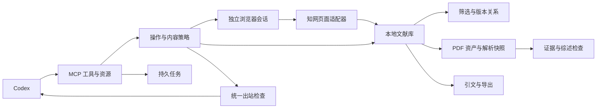

# 架构与工具契约

本地单用户 stdio 服务，无独立 Agent 调度或模型调用。官方 Python MCP SDK 的 1.x 维护分支固定在锁文件，使用 FastMCP 参数校验及结构化返回。Python 3.12 为主验证环境；Node.js 仅运行本地 citeproc-js 引文渲染子进程，不联网。

## 文件分工

| 文件 | 责任 |
| --- | --- |
| `server.py` / `__main__.py` | 工具注册、资源、工作流提示、stdio 生命周期与配置校验 |
| `app.py` | 应用用例、统一响应、项目预算、游标和输出边界 |
| `config.py` / `policy.py` | 严格学校及客户端配置、三态操作许可、来源内容输出 |
| `access.py` / `providers.py` | 临时独立上下文、精确主机检查、机构识别、受控页面操作 |
| `core.py` / `library.py` | SQLite、项目文献关系、不可变观测、作品版本、候选关系及合并回滚 |
| `screening.py` | 元数据规则与五学科模板；评分需实际证据，未知不当作零 |
| `parsing.py` / `pdf_worker.py` | 文件签名、PDF 结构、哈希、可杀死子进程解析、证据定位 |
| `reviews.py` | 矩阵、阅读层级、草稿与引用身份/引语检查 |
| `citations.py` / `js/` | 元数据格式交换、citeproc-js 本地 CSL 渲染 |
| `jobs.py` | 持久幂等键、状态、取消与显式恢复 |

SQLite `records` 存储带稳定标识的类型化实体，JSON 负载保留来源快照；`project_papers` 以外键保存项目与发表版本关系；`audit` 记录请求标识、方法、结果、错误码、耗时、阶段、任务标识和固定来源类别，不保存请求参数或正文。长任务结束、取消和中断另记 `stage=job`，与受理请求分开。数据目录采用操作系统文件锁，单目录只允许一个服务实例，避免另一进程把仍在运行的会话和任务误标为中断。退出或崩溃后操作系统释放锁；多实例需明确选择不同数据目录。

当前 schema 为 `user_version=2`。首次创建执行版本 1、2 的顺序迁移；已有版本 1 在升级前使用 SQLite backup API 生成包含已提交 WAL 页的一致数据库快照，并写出 SHA-256、版本及不可变资产保留说明的 JSON 清单，存于数据根目录的 `backups/`。升级语句和版本号在同一事务内提交；失败则回滚并释放目录锁，原始资产和解析文件保持原位。普通重启不重复备份，拒绝较新 schema 时不修改数据库。旧审计行没有耗时，保持 NULL，不伪造历史测量。

如需恢复，先停止所有使用该数据目录的服务，保留故障目录；核对备份清单中的哈希，在另一个数据目录验证数据库快照及原有 `assets/`、`parses/`。确认题录、关联和证据可读后再切换本地配置。服务不会自动用旧备份覆盖当前库，且备份不包含浏览器身份材料。

资产以 SHA-256 命名。发表版本、资产、解析产物和证据使用不同标识。相同文件跨版本复用物理存储，但授权和关联分开记录。首次读取默认选定解析快照，后续新文件不自动改变旧证据；历史重放应显式传入 `asset_id` 与 `parse_artifact_id`。

## 工具

| 分组 | 工具 |
| --- | --- |
| 项目与本地库 | `create_project`, `list_projects`, `list_papers`, `get_paper`, `import_records` |
| 学校访问 | `list_institutions`, `start_access_session`, `verify_access_session`, `close_access_session`, `get_access_status` |
| 在线检索 | `search_papers` |
| 版本与筛选 | `save_screening_policy`, `screen_papers`, `review_decision`, `resolve_duplicate`, `rollback_merge` |
| 文件与证据 | `acquire_fulltext`, `import_fulltext`, `parse_fulltext`, `read_paper`, `search_evidence` |
| 综述与导出 | `prepare_review`, `save_review`, `export_bibliography`, `export_project`, `sync_zotero` |
| 长任务 | `get_job`, `resume_job`, `cancel_job` |

资源为 `cnki://institutions`、`cnki://papers/{version_id}`、`cnki://jobs/{job_id}`。它们调用与工具相同的策略边界。提示名为 `literature_review`。

SDK 提供全部输入/输出 JSON Schema。正常和应用错误均返回 `status / data / warnings / provenance / request_id`；错误包含 `code / message / user_action / retryable / requires_user_action / job_id / request_id`。协议级无效参数由官方 SDK 拒绝并返回 MCP `isError`。长任务受理后带 `job_id`，`data.state` 表示任务状态，受理成功不等于下载或解析成功。

## 边界与恢复

- 项目限额默认 100，单次检索返回最多 20，证据每次最多 6000 字符，`top_k<=10`。许可可进一步收紧；学校范围和客户端配置分别核验。
- 在线候选上限同时取项目预算、自动检索和题录采集 `max_records` 的最小值，按项目及查询双重检查；来源结果解析只提取剩余预算内的行。检索提交同时遵守两项操作中更长的间隔；触及许可数量上限返回 `permission_budget`，不继续生成游标。
- 游标为随机本地标识，绑定项目、会话、条件、排序和配置摘要，一次消费。单页剩余题录缓存分页，不丢弃大于本次 limit 的行。页面没有变化时停止，避免重复页伪报新数据。
- 受控检索支持结构化字段；未配置的筛选或排序显式拒绝。专业检索 DSL 入口尚未开放，未暴露任意脚本、URL 请求或 shell 工具。
- 一会话一锁串行访问；每次操作重新核验精确机构标签。不同学校与不同模式不复用上下文。默认无持久 cookie，因此重启需重新认证。
- 普通网络导航最多重试两次；验证码、登录、主机变更、频繁访问均停止。频繁访问及结构变化暂停会话并记录查询停止原因。
- 解析在独立可终止子进程运行，默认超时 300 秒。退出/崩溃保留待恢复状态，外部下载不自动重放。已取消任务重复取消结果一致；需要新请求才能重新开始。
- 合并只调整作品集合，版本、引用、文件和页码标识保留。候选关系包括 extends、更正、撤稿等；后续依赖合并须先回滚，避免覆盖新映射。
- 筛选默认不限制年份，引用阈值为零；近期论文不因低引用直接排除。名单是用户提供的辅助信号，不附带商业名单。严格全文阶段未知核心项仍进入待复核。
- 综述确定性检查只验证身份、版本归属、证据存在和引语子串，不认证语义支持或论文真伪。摘要不能证明全文方法细节。

首版不包含操作系统加密会话持久化、通用 WebVPN 域名重写、商业名单、远程共享服务、CAJ 转换、OCR 或自动模型评价。以明确错误与能力状态降级，不把接口存在当作验收通过。
